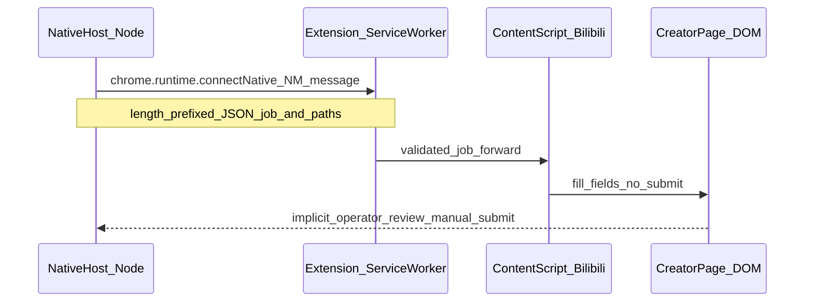

# Semi-auto Chromium extension + native host (lines 22–28)

## Current state

- Repo is **planning-only**: [todos.ts](/home/z/Documents/to-sync/projects/auto-upload/todos.ts) and [docs/bilibili-auto-upload-plans.md](/home/z/Documents/to-sync/projects/auto-upload/docs/bilibili-auto-upload-plans.md) exist; **no** `package.json`, extension, or library code yet.
- You chose **native messaging** for conveying **absolute paths** from the machine to the browser side (vs metadata-only + fully manual video pick).

## Constraints (architecture-shaping)

- **Semi-auto**: Implementation must **not** programmatically click Bilibili publish/submit by default (align with [`publish.mode` suggestions](docs/bilibili-auto-upload-plans.md)).
- **`input type=file` reality**: Chromium does not allow arbitrary “set this path” on file inputs from a normal extension/content script **without transferring bytes** through some channel or using brittle/OS-specific hacks. So the Native Messaging host should own **validation, policy, and file-size strategy** rather than implying silent multi‑GB attaches always work.

## Target layout (modular monorepo, pnpm)

| Area                    | Responsibility                                                                                                                                                                                                                                                                                          |
| ----------------------- | ------------------------------------------------------------------------------------------------------------------------------------------------------------------------------------------------------------------------------------------------------------------------------------------------------- |
| `packages/domain/`      | Versioned job schema (**Zod**), constants (field limits, timeouts, URI patterns), immutable pure helpers (normalize paths, clamp strings). **Primary Jest targets.**                                                                                                                                    |
| `packages/native-host/` | Node entry that reads stdin/writes stdout per [Chrome Native Messaging protocol](https://developer.chrome.com/docs/extensions/develop/concepts/native-messaging) (length-prefixed JSON). Validates jobs via `packages/domain`. Emits structured errors.                                                 |
| `extension/`            | MV3 Chromium extension: service worker (**TypeScript**) + typed message routing + **scoped** content script for Bilibili creator upload URLs (match patterns centralized in constants). Applies DOM fills behind feature flags (`semi` submit policy). Uses `chrome.runtime.connectNative(<hostName>)`. |
| `docs/API.md`           | Concise exports: domain public functions/types, native message envelopes, extension `chrome.runtime` message shapes, install/register steps for the host manifest.                                                                                                                                      |

## High-level workflow

## Implementation phases (minimal scope first)

1. **Tooling scaffold (root)**
   - Root `pnpm-workspace.yaml`, `package.json` scripts (`lint`: biome, `test`: jest), `biome.json`, `jest.config.*` using `ts-jest` or **`@swc/jest`** (modern TS transforms; keep deps minimal — pick one transformer and pin).
   - Path imports: **`"paths"` in `tsconfig.base.json`** (or `"imports"` convention) aligned with “project absolute imports” preference.

2. **Domain package (`packages/domain`)**
   - `PublishMode`/`SubmitPolicy` enums-as-const-objects (no programmatic submit unless explicit future opt‑in guarded).
   - `CanonicalJobSchema` (title/description/tags/partition placeholders — **explicitly versioned**, e.g. `jobVersion`).
   - Small focused functions (**<20 LoC**, immutable data): `validateJob()`, `sanitizeText()`, URL allowlist checker for injection sites.

3. **Native Messaging host (`packages/native-host`)**
   - Single responsibility modules: frame reader/writer, message router, handshake (`ping`).
   - Robust error envelopes (try/catch at IO boundaries — per your “catch possible errors”).
   - OS install docs in `docs/API.md`: Chromium host manifest JSON locations (Linux/Mac/Windows) + how to whitelist extension ID in dev vs prod builds.

4. **Extension MV3 (`extension`)**
   - `manifest.json` (**MV3**): `permissions`/`host_permissions` **minimal**, `content_scripts` matches from domain constants (`BILIBILI_CREATOR_UPLOAD_MATCHES`).
   - Service worker orchestration: reconnect policy, timeouts, telemetry logs (structured, no secrets).
   - Content script maps canonical fields → DOM (**selectors in one module** behind `CONTENT_SELECTORS` constants for churn control). Initial implementation can target **stable text inputs first** (title/description/tags) before advanced widgets.
   - **Semi-auto guard**: centralized `assertSubmitAllowed()` that **throws** / no-ops submit paths (only fills).

5. **Local video / cover strategy (explicit, honest)**
   - **Covers/thumbnails**: If under configurable max bytes, host may read → chunk → reconstruct `Blob`/`File` in extension context (with safeguards) → attempt `DataTransfer` assignment where supported — **prototype + feature flag**.
   - **Large videos**: Document and implement UX that **never pretends silent attach always works**: e.g., host verifies path/size, prompts operator via extension badge/in-page banner, optionally copies path to clipboard (OS-specific helper behind interface) — or **gates** programmatic attach under `MAX_DIRECT_ATTACH_BYTES`.
   - This satisfies “native messaging for paths” while staying technically credible.

6. **Tests (Jest) before widening surface** — per your workflow rule
   - Unit tests **only where behavior matters**: Zod refinements, message framing codec (length prefix), reducer-style pure mapping from job→field update plan. Mock DOM filling with small **jsdom**-level tests sparingly if flakiness is low — prefer keeping DOM code thin and logic in domain.

7. **Lint**: Biome on TS/JSON/markdown-as-needed (`docs/API.md`). **No prod build bundle** unless you later ask (`vite`/rolling `tsc` for extension packaging can be staged later).

8. **Features log**
   - Add **`features-logs/<today>-semi-auto-extension-native-host.md`** with a **small mermaid** flow (matching your conventions in existing logs like [features-logs/2026-05-20-extension-browser-chromium-vs-firefox.md](features-logs/2026-05-20-extension-browser-chromium-vs-firefox.md)).

9. **`docs/API.md`**
   - Enumerate exported functions/types (`packages/domain` barrel), CLI/host env vars/constants, NM message schemas (TypeScript-derived tables), extension external message IDs, install steps — **essential only**.

## Non-goals (for this MVP pass)

- **Playwright/driver** uplink — explicitly out of chosen architecture (`todos.ts` line 22).
- Published **Chrome Web Store** submission assets — developer **Load unpacked + native host manifest** doc only.
- Multi-platform adapters (YouTube/TikTok) — keep domain shape **adapter-ready** (`targets[]`), but defer implementations.

## Risks / follow-ups

- Bilibili creator DOM churn will break selectors — mitigate with **centralized selectors**, clear error overlays, versioned snapshots in tests mocked from captured minimal HTML snippets (optional later).
- Native host distribution is inherently OS-specific — keep install instructions accurate and reproducible.
