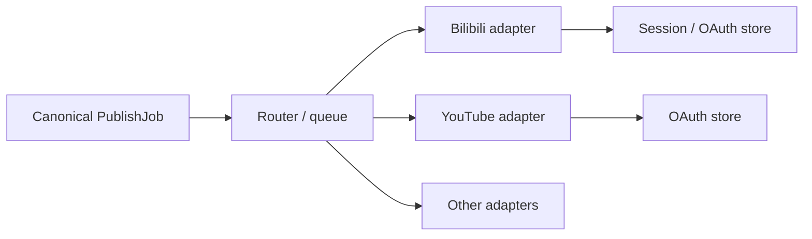
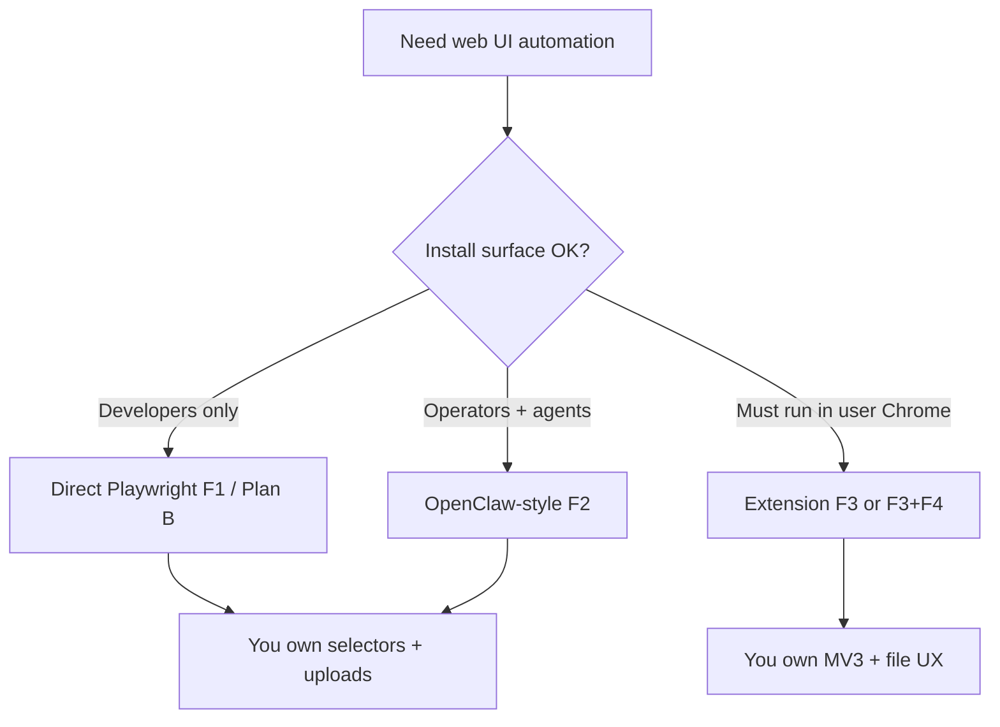
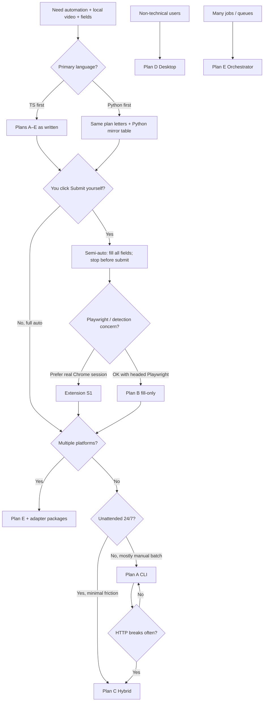

# Bilibili auto-upload tool — implementation plans (TypeScript and Python)

This document compares **proven patterns** for automating uploads (metadata + local video), with **JavaScript/TypeScript** as the default bias **and Python called out explicitly** (same plans, different toolchain). Bilibili does not publish a stable, fully documented “public developer upload API” for casual creators the way some platforms do; most tooling uses **web APIs** (cookies / tokens) or **browser automation**. Plan for **breakage when the site changes**, captchas, and **account ToS risk**.

It also covers **multi-platform** growth (YouTube, Douyin, TikTok, …) and **practical ways to reduce** (not eliminate) **account restrictions** from providers.

If your main pain is **time-consuming, error-prone typing** — not necessarily **one-click unattended publish** — prioritize [**semi-automatic mode**](#semi-automatic-workflow-fill-all-fields-manual-submit) (fill everything from a job file; **you** click **Submit**) and read [**Playwright, detection, and safer patterns**](#playwright-detection-and-safer-patterns).

---

## Shared requirements (all plans)

| Capability | Typical approach |
|------------|------------------|
| Fill title, description, tags, partition, cover, etc. | Structured config: JSON/YAML + schema validation (e.g. **Zod** or **Pydantic**) |
| Upload local video | Multipart/chunk upload (HTTP) or file picker automation (browser) |
| Auth | QR login once → persist encrypted session; or cookie import from official session |
| Observability | Structured logs, progress events, retry with backoff, idempotency keys per job |
| Safety | No secrets in repo; `.env` / OS keychain; minimal dependency footprint |
| Multi-platform | One **normalized publish job** + per-platform **adapters** (see below) |
| Account risk | Prefer **official APIs** where they exist; throttle; avoid “bot-like” bursts (see below) |
| Semi-automatic publish | Fill **all** fields (and optionally attach local video); **do not** auto-click **Publish/Submit** — operator reviews and clicks (see below) |

---

## Semi-automatic workflow (fill all fields; manual submit)

**Problem this solves:** Upload pages have **many fields**; typing them repeatedly is **slow** and **mistake-prone** (wrong partition, typos, forgotten tags).

**Target behavior:** A **single job file** (or desktop UI) holds the canonical metadata and local paths. The tool **fills every supported field** on the creator page and **stops**. **You** visually review and **click Submit/Publish** yourself — *semi-automation*, not fully unattended posting.

**Why this is often a good default:**

1. You still perform the **final human intent** (submit), which aligns with how many creators work and reduces “fully automated posting” policy ambiguity on some platforms.
2. You catch **captcha**, **warnings**, or **thumbnail** issues before anything goes live.
3. Implementation can **omit** the riskiest step — programmatic **submit** — while keeping **bulk** typing and paste work.

**Implementation options (strongest “feels like a human” first):**

| Option | How it works | Pros | Cons |
|--------|----------------|------|------|
| **S1 — Browser extension** | Content script fills inputs on the real creator site; optional native messaging reads your job file | Runs in **your normal** logged-in browser; you see exactly what the site shows | MV3 lifecycle; **file inputs** may still need a user gesture; per-site maintenance |
| **S2 — Playwright “fill-only”** | Headed browser opens studio URL; fills fields; **never** calls submit; optionally scroll/highlight | One codebase with Plan B; good for dev iteration | Still **automation-class** browser (see [Playwright detection](#playwright-detection-and-safer-patterns)) |
| **S3 — Hybrid** | HTTP or OS-level upload for the heavy file; browser fill only for metadata | Less time in the UI for big files | Two subsystems |

**Job contract (conceptual):** Add something like `publish: { mode: 'semi', submit: 'manual' }` so **no code path** can call the publish button without an explicit opt-in for full-auto tests.

### Extension (S1): which browser? Ease of build vs “detection”

**Easiest first implementation (typical industry choice):** Target **Chromium-based browsers first** — e.g. **Google Chrome** or **Microsoft Edge**. One **Manifest V3** codebase works across most Chromium flavors; documentation, examples, and developer tooling are deepest there. Add **Mozilla Firefox** as a **second** target only if you need it: it uses the same **WebExtensions** idea but has **API and lifecycle differences**, so you inherit a **second QA matrix**.

**Does one browser get “less detection”?** For **S1**, you are **not** attaching a WebDriver/Playwright driver to the tab; the page mostly behaves like **you** interacting in a normal session. Providers still enforce policy using **many signals** (account trust, content, velocity, network, anomalies). **No** mainstream browser can honestly sell **“upload here and never be flagged.”** What usually matters more than brand is **using the same browser profile you already use** for that creator site, **semi-auto submit**, and **non-spammy** behavior.

**Practical default:** Build and dogfood on **the Chromium browser you already use for uploads** (often **Chrome** or **Edge**). Ship **Chrome Web Store** (or side-loaded dev) when you need distribution; **Edge** supports the same extension model for sideloading during development.

---

## Multi-platform design (YouTube, Douyin, TikTok, Bilibili, …)

**Goal:** Add platforms without rewriting scheduling, CLI, or job files from scratch.

**Proven shape:** Treat “upload to Bilibili” as **one implementation** of a small interface, e.g. `PublishAdapter` with methods like `validateJob`, `ensureSession`, `uploadAsset`, `publish`, `healthCheck`. Shared core owns:

- **Canonical job model** — e.g. `title`, `description`, `tags`, `visibility`, `localVideoPath`, `thumbnailPath`, `scheduledAt` (optional), `platformIds` / `targets[]`.
- **Platform-specific mapping** — each adapter maps the canonical model to that site’s fields (Bilibili partition vs YouTube category vs TikTok fields).
- **Credential stores** — namespaced per platform (`youtube.oauth.json`, `bilibili.session.enc`, …), never in git.

**Platform reality (high level):**

| Platform | Typical automation path | API style |
|----------|-------------------------|-----------|
| **YouTube** | **Google API** (OAuth, YouTube Data API v3 resumable upload) | Official; best fit for “low drama” automation |
| **TikTok / Douyin** | Often **restricted** APIs (creator/business programs) or fragile unofficial flows | Prefer **documented** partner APIs if you qualify; otherwise same risks as Bilibili-style tooling |
| **Bilibili** | Community HTTP clients and/or browser automation | Unofficial / reverse-engineered; higher churn |

**Plan fit:** **Plan E** (orchestrator + workers) scales cleanly to multiple adapters. **Plans A–D** stay valid as **one adapter + shared core**; grow by adding packages like `packages/adapters/youtube`, `packages/adapters/bilibili`.

---

## Account safety: reducing blocks and flags (**no guarantees**)

Providers **cannot be “ensured”** not to flag or restrict an account. Automation, unofficial clients, spikes in traffic, or ToS interpretation can still trigger reviews, captchas, or bans. The goal is **risk reduction** and **auditability**.

**Practices that generally lower risk:**

1. **Prefer official APIs and OAuth** (e.g. YouTube Data API) over scraping where available.
2. **Throttle per account** — cap concurrent uploads, space out publishes, respect quotas and HTTP `429` / `Retry-After`.
3. **Stable auth** — refresh tokens correctly; avoid logging full tokens; rotate credentials on suspicion of leak.
4. **Browser automation** — if used, prefer **headed** flows for login and rare checkpoints; avoid hammering pages; reuse a **consistent** browser profile where appropriate (still not a guarantee).
5. **Content and behavior** — avoid duplicate spam uploads, misleading metadata, or policy-violating content; those trigger enforcement regardless of tooling.
6. **Observability** — structured errors (HTTP status, error codes) so you can stop the pipeline before repeated failed attempts look abusive.
7. **Human checkpoint** — optional pause before “publish” or when captcha / 2FA appears. For creator UIs, [**semi-automatic**](#semi-automatic-workflow-fill-all-fields-manual-submit) (fill fields; you submit) is often the safest default when it fits your workflow.

**Plans and risk posture:**

- **Lower inherent risk (where official API exists):** YouTube via Google API; still subject to quota and policy.
- **Higher inherent risk:** Unofficial HTTP + cookie sessions; headless-only login; high-frequency unattended runs across many accounts.

This is guidance only; **compliance is your responsibility** on each platform.

---

## Playwright, detection, and safer patterns

**Concern (valid):** Some sites **discourage or block** unattended automation. Vendors may use **many signals** (network behavior, headless traits, timing, session history, and more). Those signals **change** over time. **No** approach can honestly promise undetectability or “never blocked.”

**What “safer” usually means in practice (risk reduction, not a guarantee):**

1. **Prefer official APIs** where they exist (e.g. YouTube Data API) so **that platform** never depends on a scripted browser for the core upload.
2. **Semi-automatic mode** — fill fields; **you** submit — avoids automating the highest-intent action and gives you a **review gate** (see [Semi-automatic workflow](#semi-automatic-workflow-fill-all-fields-manual-submit)).
3. **Avoid full-unattended headless publish** when your goal is to mirror a human; that path often hits **captchas** and stricter checks first.
4. **If you use Playwright:** favor **headed** runs, **realistic pacing** (delays between actions), **persistent user data dir** where policy allows, and **one account / one profile** consistency. Do **not** rely on third-party “undetectable” patches as a policy or security baseline — they are **brittle** and may violate terms.
5. **Extension in your daily browser (S1)** — the automation surface is “page script + your real session,” which many operators find **closer** to manual operation than a separate Chromium instance — at the cost of extension engineering (permissions, MV3, file pickers).
6. **Stop on anomaly** — if the page shows captcha, warning, or unexpected layout, **do not** retry in a tight loop; surface a clear log and wait for human intervention.

**Relationship to Plans F1–F4:** [Browser automation beyond Plan B](#browser-automation-beyond-plan-b-openclaw-extensions-and-direct-drivers) lists architectures; combine **S1 extension** with **semi-auto** when your priority is **real-browser** session + **manual submit**.

---

## Python stack mirror (same Plans A–E, different libraries)

The **architecture** in this document — canonical job, `PublishAdapter`, throttling, multi-platform routing — is **language-agnostic**. Python is a first-class alternative; map each plan as follows.

| Plan | Typical Python stack |
|------|----------------------|
| **A — CLI + HTTP** | **Typer** or **Click** for CLI; **httpx** (sync or async) or **requests** for HTTP; **Pydantic** v2 for job/settings validation; **structlog** or stdlib **logging** with JSON; **pytest** for pure functions (paths, chunk math, config merge) |
| **B — Browser automation** | **Playwright for Python** (same upstream Playwright as the Node binding) |
| **C — Hybrid** | `httpx` (or a small internal client) for upload/metadata + Playwright only for login, captcha, or UI-only gaps |
| **D — Desktop** | **PySide6** / **PyQt6** for native UI, or **Flet** / **Textual** for lighter surfaces; alternatively keep **Tauri/Electron** and call a Python worker over IPC/HTTP |
| **E — Orchestrator** | **Celery** + Redis/RabbitMQ, **RQ**, **Dramatiq**, or **ARQ** (async); SQLite or Postgres for job state; optional **FastAPI** for a small operator API |

**Dependency hygiene (Python):** Pin versions (`uv.lock` / `requirements.lock`); run **`pip-audit`** or your toolchain’s equivalent on a schedule; keep optional heavy deps (browser, GUI) in **extras** so headless workers stay lean.

**When Python is often a strong fit:** The team already ships Python; you lean on **Google APIs** for YouTube (`google-api-python-client` + OAuth); you sit next to **ffmpeg** / media scripting; you want **uv**-managed environments.

**When TypeScript is often a strong fit:** You want one language across **CLI + web/Electron/Tauri** UI; you pick a maintained **npm**-ecosystem uploader for a specific platform.

**Polyglot (proven in larger systems):** Keep the **job schema and queue** in one language, run **per-platform workers** in whichever stack has the best-maintained client — integrate via **subprocess**, **HTTP**, or **gRPC**, with strict timeouts and structured stderr/stdout contracts.

---

## Plan A — TypeScript CLI + community HTTP client (recommended baseline)

**Idea:** A small **Node.js CLI** that reads a **job file** (fields + path to video), authenticates, uploads via HTTP, and submits the post.

**Stack**

- **Runtime:** Node.js LTS (≥ 18)
- **Language:** TypeScript
- **HTTP / upload:** Thin wrapper around maintained Bilibili-oriented libraries (evaluate **maintenance + license** before locking in), or direct `fetch` if you control the protocol yourself
- **Config & validation:** `zod` + JSON/YAML
- **CLI:** `commander` or `cac` (keep surface small)
- **Testing:** Vitest for pure functions (paths, chunking math, config merge)

**Pros:** Fast, scriptable, good for CI/cron, clear separation of “config” vs “code”.  
**Cons:** Depends on **unofficial** API behavior; may need updates after site changes.

**When to choose:** You want **automation first**, minimal UI, reproducible jobs.

---

## Plan B — Playwright-driven “creator studio” automation

**Idea:** Drive the **official web uploader** in a browser: navigate, set fields, attach file, and — **only if you explicitly want full automation** — submit.

**Modes**

- **Semi-automatic (often best fit):** Fill **all** fields (and attach local video when the flow allows). **Do not** invoke the submit/publish selector; pause so **you** click **Submit** ([Semi-automatic workflow](#semi-automatic-workflow-fill-all-fields-manual-submit)). Treat this as the default product behavior when your priority is **speed + fewer mistakes** without claiming unattended posting.
- **Full automation:** Same flow but script clicks publish. Higher chance of **captchas** and policy friction; see [Playwright, detection, and safer patterns](#playwright-detection-and-safer-patterns).

**Stack**

- **Runtime:** Node.js + TypeScript
- **Automation:** Playwright
- **Config:** Same JSON/YAML job format as Plan A (reuse parsers); include `publish.mode` / `submit` policy in schema
- **Optional:** Human-in-the-loop for captcha / sensitive steps

**Pros:** Often survives **smaller** API reshuffles if the DOM flow is stable; uses the same UI a human uses. **Semi-auto** keeps the **final click** under human control.  
**Cons:** Slower, flakier (selectors, A/B tests), harder in CI; captchas can block fully unattended runs. **Automation-class browsers** may be scored differently than your everyday Chrome profile — see detection section above.

**When to choose:** HTTP path is blocked or too volatile, or you need behavior that only exists in the web UI. Prefer **semi-auto** first if you worry about **blocking** or **Playwright-style detection**.

**See also** [Browser automation beyond Plan B](#browser-automation-beyond-plan-b-openclaw-extensions-and-direct-drivers) for **OpenClaw-style** managed browsers vs **browser extensions** vs raw drivers.

---

## Plan C — Hybrid (HTTP upload + Playwright only for auth / edge cases)

**Idea:** Use **HTTP** for upload + metadata when possible; fall back to **Playwright** for login refresh, captcha checkpoints, or rare UI-only steps.

**Stack**

- TypeScript monorepo or single package with two modules: `uploader-http`, `uploader-browser`
- Shared: job schema, logging, retry policy

**Pros:** Best balance of speed and resilience for real accounts.  
**Cons:** Two subsystems to maintain; more integration tests needed.

**When to choose:** Production-ish tool for a single operator or small team.

---

## Plan D — Desktop shell (Electron or Tauri + JS frontend)

**Idea:** Wrap Plans A–C in a **small GUI**: pick file, edit fields, queue jobs, show progress.

**Stack**

- **Shell:** Tauri (Rust + web UI) *or* Electron — UI in **Vue/React/Svelte**
- **Core:** Reuse the same TS library as the CLI (shared package)
- **Storage:** Local encrypted token store

**Pros:** Friendly for non-developers; drag-and-drop.  
**Cons:** Larger build/signing story; more attack surface if dependencies grow.

**When to choose:** You need a **product-like** experience, not just a script.

---

## Plan E — “Thin orchestrator” + external uploader binary

**Idea:** Keep your repo as a **scheduler/queue** (BullMQ + Redis, or cron + SQLite) that shells out to a maintained uploader or calls a small sidecar service.

**Stack**

- Node.js + TypeScript orchestration
- Job store: SQLite or Redis
- Worker process with concurrency limits

**Pros:** Clear boundaries; easy to swap upload engine.  
**Cons:** Operational complexity (processes, queues).

**When to choose:** Many videos, retries, priorities, multiple accounts (handle with care and within platform rules). **Best default** when you already know you want **Bilibili + YouTube + …** behind one queue and shared job format.

---

## Browser automation beyond Plan B: OpenClaw, extensions, and direct drivers

Plan B already uses **Playwright** to drive the **official web UI**. This section compares **how** you host that automation: **your own Playwright scripts**, an **OpenClaw-style managed browser**, or a **browser extension**. All remain **browser automation** (not a substitute for **official HTTP/API** paths where they exist, e.g. YouTube Data API).

| Approach | What it is | Main pros | Main cons |
|----------|------------|-----------|-----------|
| **F1 — Direct Playwright / Puppeteer (Plan B)** | Your TypeScript (or Python) repo owns launch, cookies, selectors, retries | Full control; **battle-tested OSS**; same stack as CI patterns everywhere | You maintain **selectors** and **anti-bot** churn; file inputs and captchas are **your problem** |
| **F2 — OpenClaw-managed browser** | A separate **agent-oriented** layer (OpenClaw is one example) runs a **dedicated browser profile** (e.g. isolated Chromium user data) and exposes **CLI/API** for navigate, click, type, snapshot; implementation is typically **Playwright-class** under the hood | **Isolation** from the user’s daily browser; documented **snapshot** / debugging flows; fits **AI-assisted** or “operator drives one browser” workflows | **Extra dependency** and release cadence; still **breaks** when the site DOM or upload flow changes; **not a platform guarantee** against flags or bans |
| **F3 — Browser extension (Chrome MV3 / Firefox)** | MV3 **service worker** + **content scripts** on the creator URL; optional **native messaging** to a local helper for file paths | Runs in a **real** user session if the user is already logged in; can feel closer to “manual” operation for some checks; no separate “launch Chromium” step for the operator | **MV3** limits (lifecycle, networking); **local file → `<input type=file>`** is awkward and often needs a **user gesture** or native bridge; **store review** and **permissions** if you publish; **cross-browser** maintenance |
| **F4 — Extension + native messaging host** | Extension talks to a **small local binary** (stdin/JSON) that your CLI/orchestrator controls | Path to pass **absolute file paths** and orchestrate queues from Plan E **without** full remote debugging | **Install story** (three OSes, policies); **security review** burden; more moving parts than F1 |

**OpenClaw nuance (example of F2):** Projects like OpenClaw document a **managed profile** (separate from personal Chrome) and browser control aimed at **deterministic agent use**. Treat it as **orchestration + profile hygiene**, not as a bypass for provider rules. See upstream docs for current flags and requirements, e.g. [OpenClaw browser tools](https://docs.openclaw.ai/tools/browser).

**When extensions (F3/F4) win:** You need the tool **inside** the user’s normal browser, or **upload** must use the **same** session cookies/UI as a long-lived login without exporting secrets to a headless profile.

**When direct Playwright (F1 / Plan B) wins:** You want one repo, one CI story, and **no** Web Store or extension install path.

**When OpenClaw-style (F2) wins:** You already standardize on that stack for **agent** workflows, or you want **strong isolation** and a **packaged** browser control UX without writing all launch/profile code yourself.

---

## Security & compliance checklist (all plans)

1. **Secrets:** Never commit cookies/tokens; use OS secret storage or encrypted files outside git.
2. **Dependencies:** Prefer **few, audited** packages; pin versions; enable **`pnpm audit` / Dependabot** (Node) and **`pip-audit`** or lockfile-aware audits (Python).
3. **Rate limiting:** Exponential backoff; respect platform limits.
4. **Legal/ToS:** Automating uploads may conflict with terms; use only on accounts you control and within allowed use.

---

## Suggested decision path

**Pragmatic default:** If your pain is **slow, error-prone typing** and you are fine **clicking Submit** yourself, start with [**semi-automatic**](#semi-automatic-workflow-fill-all-fields-manual-submit): **extension S1** when you want your **normal Chrome session** and stronger “manual” feel; otherwise **Plan B (fill-only)**. If you need **fully unattended** publish, expect more **captchas**/checks — read [**Playwright, detection, and safer patterns**](#playwright-detection-and-safer-patterns) and still **prefer official APIs** (e.g. YouTube) where possible. For **HTTP-stable** upload to a given site, **Plan A** remains the smallest blast radius. Pick **TypeScript or Python** from the mirror table and extract **job schema** + **auth storage** early.

---

## Next implementation steps (after picking a plan)

1. Define a **versioned canonical job schema** (fields + `videoPath` + optional `coverPath` + `targets[]` + **`publish`**: semi vs full-auto, **never default** to programmatic submit without explicit opt-in).
2. Sketch `PublishAdapter` (validate, auth, upload, publish) before writing Bilibili-specific code.
3. Implement **auth persistence** per platform with rotation and clear error messages.
4. Implement **upload with progress** + resumable chunks where the platform supports it.
5. Add **dry-run** mode (validate config and auth without submitting).
6. Document **recovery** (partial upload, duplicate title, rejected partition / category).
7. Add **per-account rate limits** and global concurrency caps in the orchestrator (Plan E) or CLI flags (Plan A).

This file is planning-only; it does not implement uploads or bypass platform protections.
