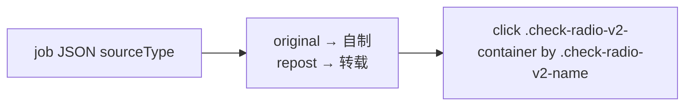

# Bilibili source type (自制 / 转载)

## Job field

`bilibili.sourceType`: `"original"` | `"repost"`

## Workflow

## Paths

- [`packages/domain/src/constants/bilibili-source-type.ts`](../packages/domain/src/constants/bilibili-source-type.ts)
- [`extension/src/content/click-radio-by-label.ts`](../extension/src/content/click-radio-by-label.ts)
