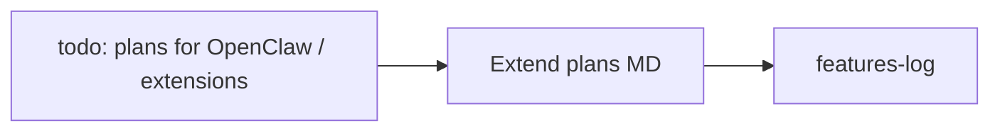

# Change: Plans doc — browser automation (OpenClaw, extensions)

## Summary

Added `docs/bilibili-auto-upload-plans.md` section **Browser automation beyond Plan B** with approaches F1–F4 (direct Playwright, OpenClaw-managed browser, MV3 extension, extension + native messaging), pros/cons table, OpenClaw pointer to upstream docs, when-to-pick guidance, and a small decision mermaid. Linked from Plan B.

## Workflow

## Files

- `docs/bilibili-auto-upload-plans.md`
- `features-logs/2026-05-20-browser-automation-openclaw-extensions.md`
