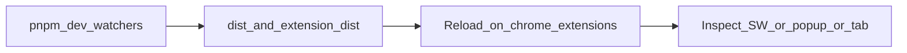

# Change: Dev watch + editor launch (no reload-unpacked churn)

## Summary

Added **`pnpm dev`** concurrent watchers (`tsc --watch` for domain + native-host, `esbuild` watch for extension), **`--watch`** on [`scripts/build-extension.mjs`](../scripts/build-extension.mjs), VS Code/Cursor [**tasks**](../.vscode/tasks.json) + [**launch**](../.vscode/launch.json), and documented the **one-click Reload** rhythm (Chromium cannot hot-reload unpacked MV3 artifacts).

## Workflow

## Files

- [`package.json`](../package.json), [`scripts/dev.mjs`](../scripts/dev.mjs), [`scripts/build-extension.mjs`](../scripts/build-extension.mjs)
- [`.vscode/tasks.json`](../.vscode/tasks.json), [`.vscode/launch.json`](../.vscode/launch.json)
- [`docs/API.md`](../docs/API.md)
