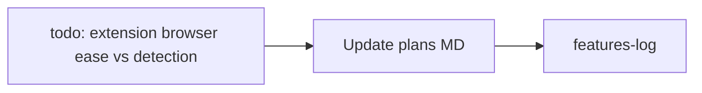

# Change: Plans doc — extension browser choice

## Summary

Added subsection **Extension (S1): which browser?** under semi-automatic workflow in `docs/bilibili-auto-upload-plans.md`: Chromium-first (Chrome/Edge) for simplest MV3 implementation; Firefox as optional second target; honest framing that **no** browser guarantees lower “detection”; S1 avoids WebDriver-style automation but policy/behavior still dominate; practical default to use the **same** Chromium profile you already upload with.

## Workflow

## Files

- `docs/bilibili-auto-upload-plans.md`
- `features-logs/2026-05-20-extension-browser-chromium-vs-firefox.md`
