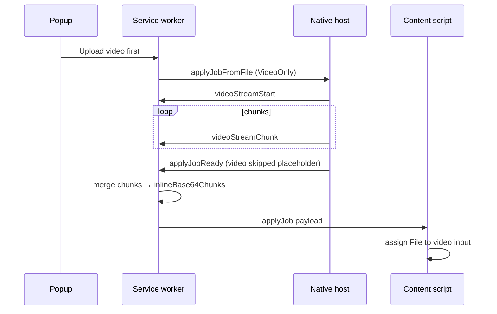

# Large attachment streaming (native host → extension)

## Cover streaming (Fill fields fix)

Covers larger than ~400 KiB are sent as `coverStreamStart` + `coverStreamChunk` (same 1 MiB Chrome frame limit as video). Fixes `native_message_payload_invalid` on **Fill fields** when `localCoverPath` points to a large PNG/JPG.

Merged cover payload uses `inlineBase64Chunks` (decode per chunk, not `join("")` on base64 strings) — fixes `atob` / invalid base64 on streamed covers.

# Large video streaming (native host → extension)

## Change

Videos larger than `MAX_NATIVE_INLINE_VIDEO_BYTES` (~400 KiB) but within `maxDirectAttachBytes` (default 32 MiB) are sent as `videoStreamStart` + `videoStreamChunk` frames; the service worker merges chunks into `inlineBase64Chunks` before the content script assigns the file input.

## Workflow

## Paths

- [`packages/native-host/src/attachments/resolve-video-attachment.ts`](../packages/native-host/src/attachments/resolve-video-attachment.ts)
- [`extension/src/sw/post-native-message-session.ts`](../extension/src/sw/post-native-message-session.ts)
- [`extension/src/sw/merge-video-stream-into-payload.ts`](../extension/src/sw/merge-video-stream-into-payload.ts)
