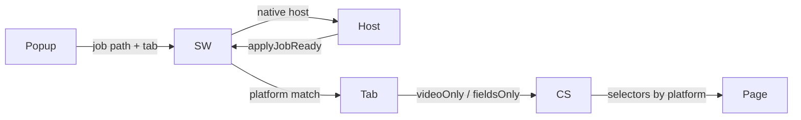

# Multi-platform: Douyin + 微信视频号 (basic fields)

## Scope

- Job v2 `platform`: `bilibili` | `douyin` | `channels`
- Basic text: `douyin.title` / `description`, `channels.title` / `description`
- Bilibili unchanged (tags, partition, cover modal, etc.)
- Cover apply remains **Bilibili-only**

## Workflow

## Files

- Domain: `platform.ts`, `canonical-job` v2 union, `detectPlatformFromUrl`
- Extension: `platforms/douyin`, `platforms/channels` (WeChat `.upload-content` video picker), `content-platform-fill.js`
- Examples: `examples/douyin.job.example.json`, `examples/channels.job.example.json`

## Usage

1. Open creator upload tab (Douyin / 视频号 / Bilibili).
2. Popup: **Upload video first** → **Fill fields**.
3. Job `platform` must match the active tab URL.
