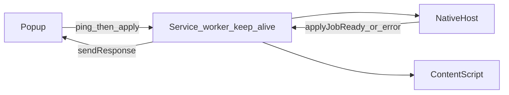

# Change: Fix popup stuck on “Requesting native host…”

## Summary

MV3 service worker could stop before `sendResponse`, so `chrome.runtime.sendMessage` never resolved. Added keep-alive during native host work, popup timeout + callback-based `sendMessage`, disconnect/message race grace, host outbound size guard, and fallback error write when framing fails.

## Workflow

## Files

- `extension/src/sw.ts`, `extension/src/sw/*`, `extension/src/popup/*`
- `packages/native-host/src/main.ts`, `packages/native-host/src/router/handle-host-inbound-message.ts`
