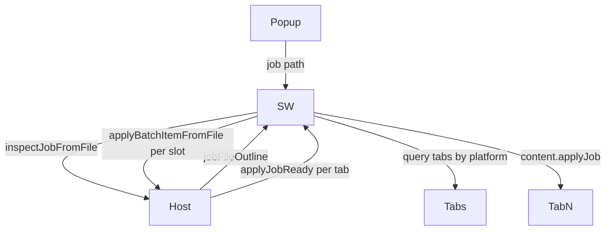

# Batch job v3 + fill one tab per item

## Scenario

- One `job.json` with multiple items (same video per item, different platform field blocks).
- Open **one upload tab per item per platform** (tab count ≥ item count for that platform).
- Popup **Upload all tabs** / **Fill all tabs** maps tabs (by tab id order) to job items.

## Job v3 shape

- **`assetsParentFolder`**: absolute path.
- **`name`** (one per item): used as **title** and as the file stem → `{name}.mp4` (video), `{name}.png` (cover). Set **`includeCover": false`** when there is no cover image.
- **Shared text**: `description`; Bilibili extras `tags`, `sourceType`, `partition`.

```json
{
  "jobVersion": 3,
  "assetsParentFolder": "/abs/media",
  "items": [
    {
      "targets": ["bilibili", "douyin"],
      "name": "my-video-stem",
      "description": "Same description"
    }
  ]
}
```

v1/v2 single-platform jobs unchanged. Example: [`examples/batch.job.example.json`](../examples/batch.job.example.json).

## Workflow



## Usage

1. Prepare batch `job.json` (v3).
2. Open upload tabs: e.g. 2 Douyin tabs for 2 Douyin items, 1 Bilibili tab for 1 Bilibili item.
3. **3. Upload video (all tabs)** then wait for uploads.
4. **4. Fill fields (all tabs)** — review each tab and publish manually.

## Preflight tab check

Before **any** tab receives video or fields, the service worker validates **bilibili**, **douyin**, and **channels (视频号)**. Short counts return `insufficient_tabs` with all shortages in one message; **no partial upload**.

Douyin tabs count after video upload when the URL is the publish/metadata page (`/creator-micro/content/post/video`), not only the initial `/content/upload` picker page.

## Preflight asset files (video + cover)

Host `checkBatchJobAssetsFromFile` runs before upload and before fill. Per item (default): `{name}.mp4` + `{name}.png` under `assetsParentFolder`. `includeCover: false` skips cover only. Missing paths return `batch_assets_missing` with `missing video file` / `missing cover file` entries; **no tab is updated**.

Extension popup is **batch-only** (v3): **1. Upload video (all tabs)** / **2. Fill fields (all tabs)**. v1/v2 single-tab popup actions removed.
