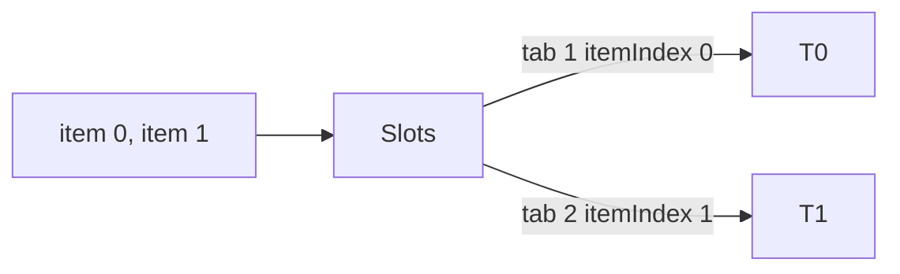

# Fix: all batch items upload video per platform

## Problem

Only the first job item’s video appeared on every platform tab. Later items were skipped or reused item `0`.

## Cause

Optional `itemIndex` on `applyJobFromFile` risked omitting `0` in messaging; batch apply also released the service worker keep-alive between tabs.

## Fix

- New host message `applyBatchItemFromFile` with **required** `itemIndex` + `platform`
- `listOutlineItemIndicesForPlatform` — sorted indices per platform for tab mapping
- One service-worker keep-alive for the full batch loop
- Each slot: `applyBatchItemViaNativeHost` → correct `{name}.mp4` for that item

## Rule (N items → N tabs per platform)

For each platform, count `items[]` whose `targets` include that platform. Open that many upload tabs. Pair by tab id (ascending): 1st tab → 1st matching item, 2nd tab → 2nd matching item.

Example: 2 items both target `douyin` → 2 Douyin tabs, each gets a different `{name}.mp4`.

Only **upload page** tabs count (`/platform/upload`, creator upload URL, channels create URL). Homepage tabs on the same domain are ignored.

Payload includes `batch.itemIndex` + `batch.targetPlatform`; content script rejects wrong video file before assign.

## Bilibili / 视频号 = same batch rule as Douyin

| Platform | N job items with target | Need | Tab slot → item |
|----------|-------------------------|------|-----------------|
| douyin | 2 | 2 upload tabs | tab₀→item 0, tab₁→item 1 |
| bilibili | 2 | 2 upload tabs | same |
| channels | 2 | 2 upload tabs | same |

- `waitForPlatformVideoFileInput` — poll only platform-scoped finders (no ambiguous document-wide pick)
- Bilibili/channels: video `input` must sit inside video upload area (not cover image input)
- Douyin-style: resolve upload area from file input first
- Same-origin `iframe` in `queryAllDeep`; channels longer post-click settle (600ms)
- `batch_video_mismatch` if payload video name ≠ projected item `{name}.mp4`

## Workflow

