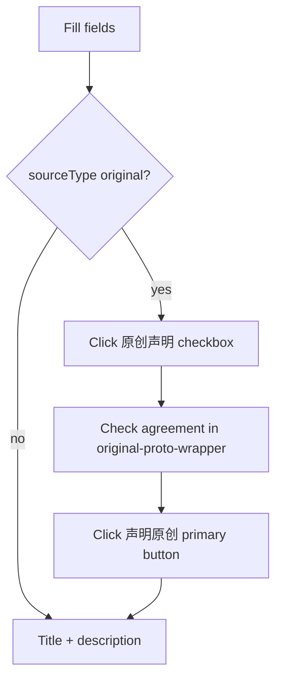

# 视频号 title / description / 原创声明

## Scope

- Title: `input.weui-desktop-form__input` placeholder 概括视频主要内容…
- Description: `div.input-editor[contenteditable][data-placeholder="添加描述"]`
- `sourceType: "original"` → checkbox + `.original-proto-wrapper` 协议确认

## Workflow



## Job

```json
"channels": { "title": "…", "description": "…", "sourceType": "original" }
```

Batch item `sourceType` projects to channels the same as bilibili.
