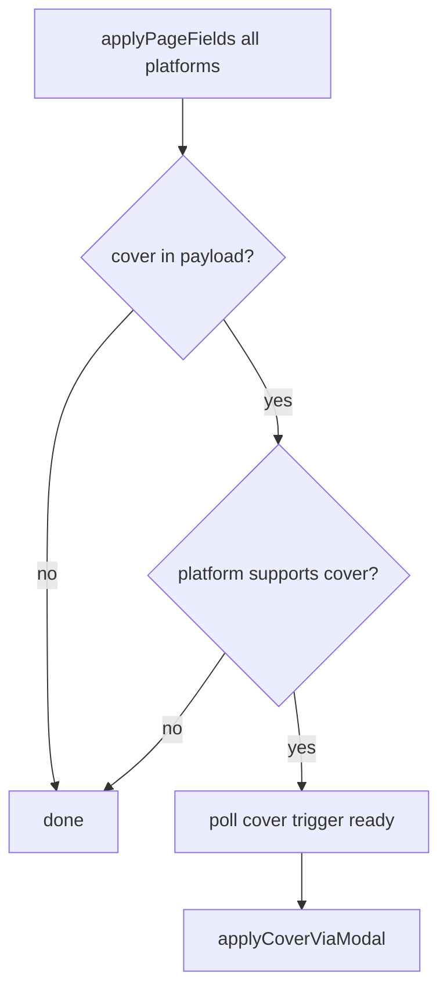

# Cover last on fill fields — poll, not fixed delays

## Workflow

## Changes

- Removed fixed `waitMs` delays before cover (tag count × ms, dismiss settle, retry gaps)
- `waitForFieldsReadyBeforeCover` — polls until `.cover-img` / 封面设置 trigger exists
- Tags — `waitForTagInputCleared` after Enter (poll until input empty)
- Cover modal — poll until upload area + file input; trigger re-click only if modal missing
- Same order on every platform tab: **fields first, cover last** (cover runs only where UI exists: bilibili today)
