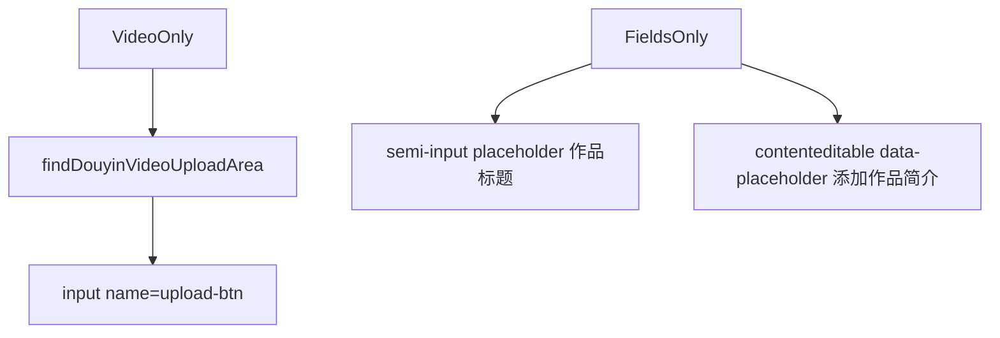

# Douyin upload area + title/description selectors

## Scope

Match Douyin creator upload DOM: named video file input, semi-input title, editor description.

## Workflow

## Files

- `extension/src/platforms/douyin/douyin-selectors.ts`
- `extension/src/platforms/douyin/find-douyin-video-upload-area.ts`
- `extension/src/platforms/douyin/douyin-video-upload-trigger.ts`
- `extension/src/content/dom.ts` — `pickFirstElementDeep` for shadow DOM fields
