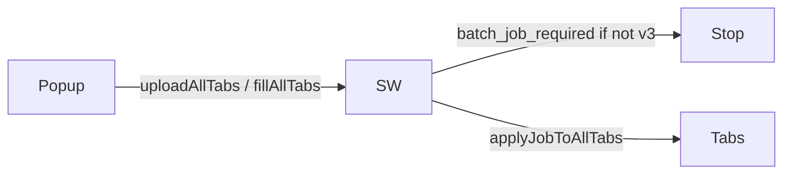

# Extension: batch-only popup

## Change

Removed single-tab upload/fill (v1/v2) from popup and service worker. Extension accepts **jobVersion 3** batch files only.

## Workflow

## Popup

1. Upload video (all tabs)
2. Fill fields (all tabs)
