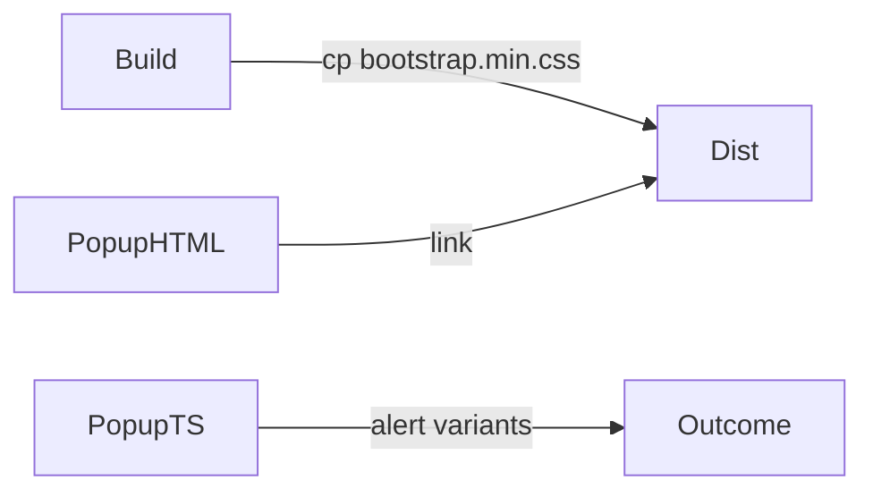

# Popup UI — Bootstrap 5.3.8

## Scope

- Local vendored CSS: [`assets/bootstrap-5.3.8`](../assets/bootstrap-5.3.8)
- Copied to `extension/dist/vendor/bootstrap/` on build
- Simple layout: header, job path input, active-tab vs batch sections, status alert

## Workflow

## Usage

Run `pnpm build` or `pnpm dev`, reload extension, open popup.
