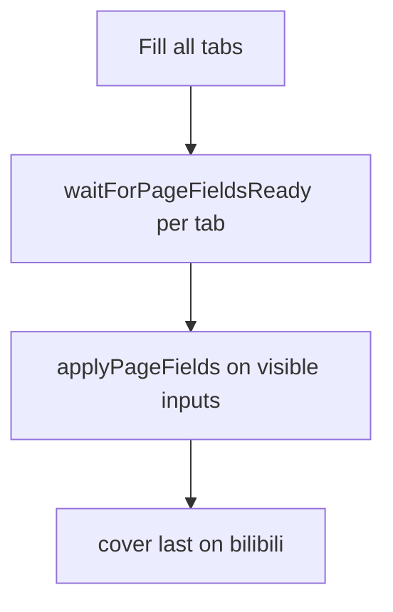

# Fix: batch fill fields on every Bilibili tab (visible targets)

## Problem

Fill fields updated only the first batch item on Bilibili. Later tabs stayed empty or kept the wrong title.

## Cause

`pickFirstElementDeep` chose the first DOM match, including **hidden** inputs left from the upload step. Values were written to off-screen controls, not the visible metadata form.

## Fix

- `pickFirstVisibleElementDeep` — prefers visible elements (`isElementVisible`)
- `waitForPageFieldsReady` — polls until a visible Bilibili title input exists
- `findFieldElement` uses visible picker for selector fallbacks
- Tags, source-type radio, partition heading/option — visible-only targeting

## Workflow

