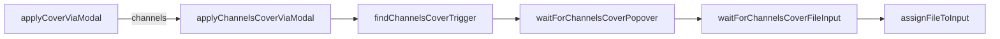

# Channels cover popover pipeline

## Problem

Runtime logs: Channels cover failed with `uploadAreaFound: false` on generic `apply-cover-via-modal` path (lines 58–64). Douyin/Bilibili succeeded after platform-specific pipelines.

## Fix

Dedicated `applyChannelsCoverViaModal`: click `编辑` on cover wrap → wait for popover → assign image `input`.

Douyin: prefer `[class*="semi-upload"] > div` before drag-main text for click target.

## Files

- `extension/src/platforms/channels/apply-channels-cover-via-modal.ts`
- `extension/src/platforms/channels/wait-for-channels-cover-popover.ts`
- `extension/src/content/apply-cover-via-modal.ts` (delegate Channels)
