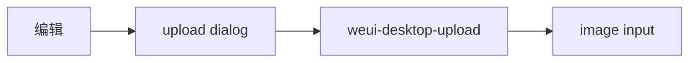

# Channels cover: exclude page wrap, target upload dialog

## Problem

Logs: `popoverFound: true`, `inputFound: false`. `.vertical-cover-wrap.img-popover-wrap` on the page matched as popover (has 封面 text) but has no file input.

## Fix

Two-step like Douyin:

1. Click `编辑` on cover wrap
2. Wait for `weui-desktop-popover` / dialog with image `input` or `.weui-desktop-upload` (exclude page cover wrap)
3. Click upload target → assign file → UI verify

