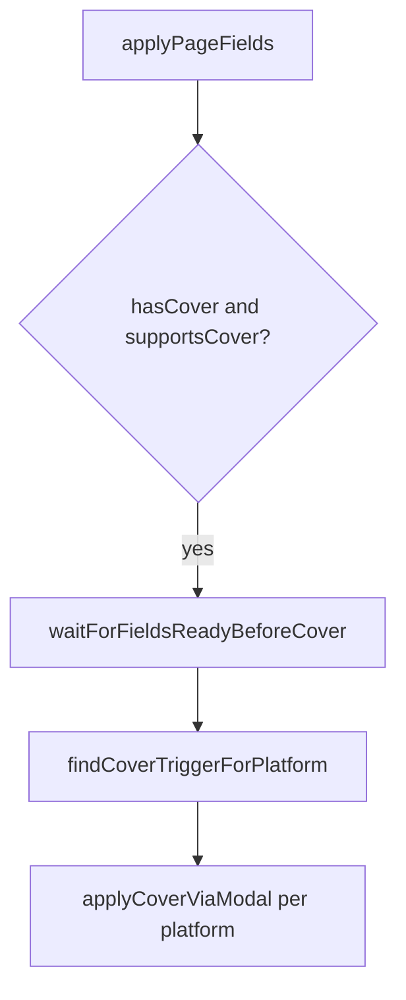

# Douyin + Channels cover upload on fill fields

## Problem

Fill fields uploaded covers on Bilibili only. Douyin and Channels had `hasCover: true` but `platformSupportsCoverUpload` was false.

## Fix

- Enable cover for all `PLATFORM_IDS`
- Platform-specific cover triggers:
  - **Douyin:** `选择封面` filter (`title-*` inside `filter-*`)
  - **Channels:** `编辑` in `.vertical-cover-wrap` / `.horizon-cover-wrap`
- Platform-aware modal upload area + visible image `input[type=file]` fallback
- **Douyin cover modal:** scope to `#dy-creator-content-modal-body`, click `[class*="semi-upload"] > div`, then assign image `input` inside modal

## Workflow

