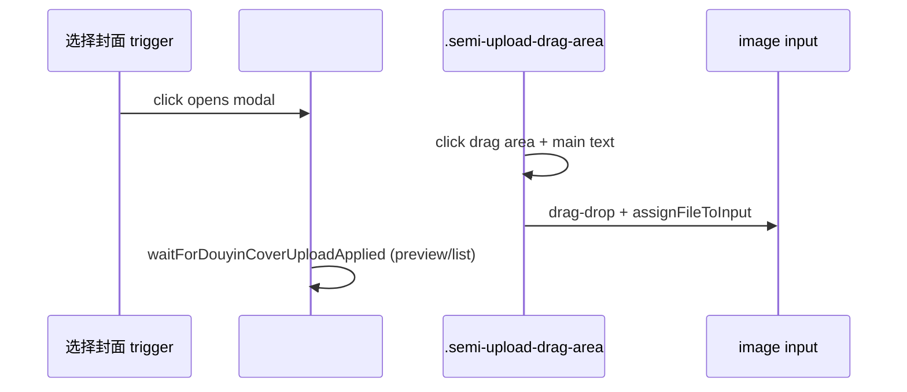

# Douyin cover: step-2 drag area + UI verify

## Problem

Logs showed `douyin_cover_assigned` / `cover_upload_done` but user saw no cover. Modal opened (step 1) but step 2 (`.semi-upload-drag-area`) was not used correctly; DOM `files` assignment is a false positive for Semi Upload.

## Fix

- Step 2: `findDouyinCoverDragArea` + click main text
- Success only when `douyinCoverUploadLooksApplied` (not `inputHasAssignedFile` alone)
