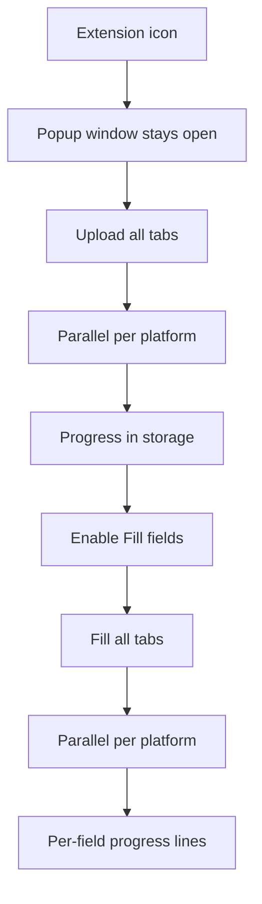

# Enhancements: batch popup, timing, concurrency, host setup

## Scope

- Bootstrap popup UI (existing) + persistent control window via `chrome.action.onClicked`
- Optional `targets` on batch items → defaults to bilibili, douyin, channels
- Platform-parallel batch apply (`Promise.all` per platform)
- Bilibili partition wait before fill (fixes `page_fields_not_found:分区 → …` timing)
- Per-field / video / cover progress log in popup
- Fill fields disabled until upload-all succeeds for same job path
- `scripts/setup-host.sh` one-shot host setup
- Dev: copy Bootstrap CSS once per esbuild watch session

## Workflow



## Usage

```bash
./scripts/setup-host.sh <extension-id>
pnpm dev
```

Click the toolbar icon (not a dropdown) to open the control window.
