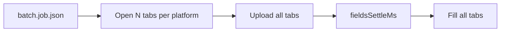

# Popup: open platform tabs + upload-and-fill

## Scope

- Per-platform buttons open N upload tabs (N = job items targeting that platform)
- Single **Upload and fill** replaces separate upload / fill steps
- Configurable `fieldsSettleMs` (storage + popup input) between upload and fill phases
- Within each platform, job items run **in parallel** with a **random 1–3 s** stagger before each item starts

## Workflow

## Usage

Set **Wait after upload before fill (ms)** (default 2000). Click **bilibili** / **douyin** / **视频号** to open tabs, then **Upload and fill (all tabs)**.
