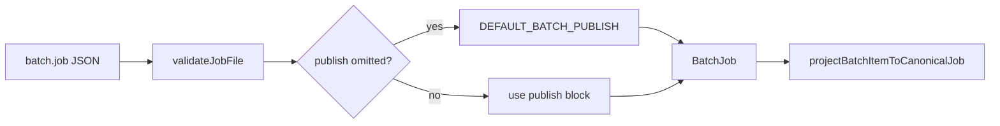

# Batch example: omit optional default fields

## Change

- `publish` on batch jobs defaults to `{ mode: "semi", submit: "manual" }` when omitted (`DEFAULT_BATCH_PUBLISH`).
- `examples/batch.job.example.json` drops optional fields that match defaults: `publish`, per-item `targets`, `sourceType`, `partition`.
- Per-item `description` may be omitted or empty; `resolveBatchItemDescription` uses `name` when description is falsy.

## Workflow

