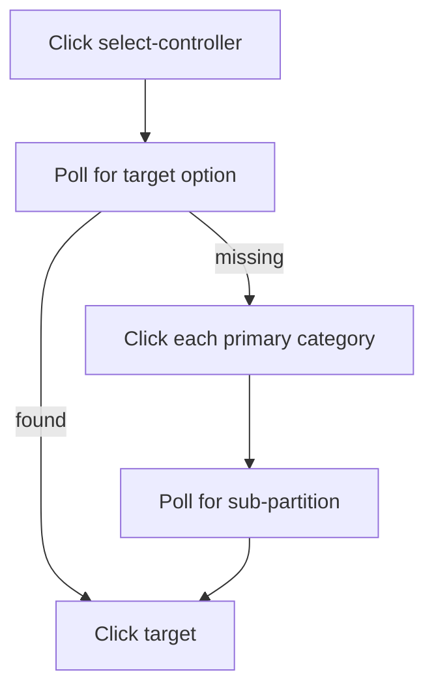

# Fix: Bilibili partition fill (分区 → 人工智能)

## Problem

Fill fields failed with `page_fields_not_found:分区 → 人工智能` even when the partition control was visible on the upload page.

## Causes

1. **Timing** — dropdown options render after `.select-controller` is clicked; the old code picked synchronously.
2. **Two-level partitions** — labels like `人工智能` appear only after opening a primary category (e.g. `科技`).
3. **DOM depth** — partition controls/options may sit in shadow roots; plain `querySelectorAll` missed them.

## Fix

- Deep query (`queryAllDeep`) for heading, controller, and `.select-item-cont` options.
- Poll up to 4s for the target option after opening the dropdown.
- If the target is not top-level, click each visible primary option and poll for the sub-partition.
- Use `dispatchClick` for React-style controls.

## Workflow

## Paths

- `extension/src/platforms/bilibili/select-bilibili-partition-value.ts`
- `extension/src/platforms/bilibili/find-bilibili-partition-select-controller.ts`
