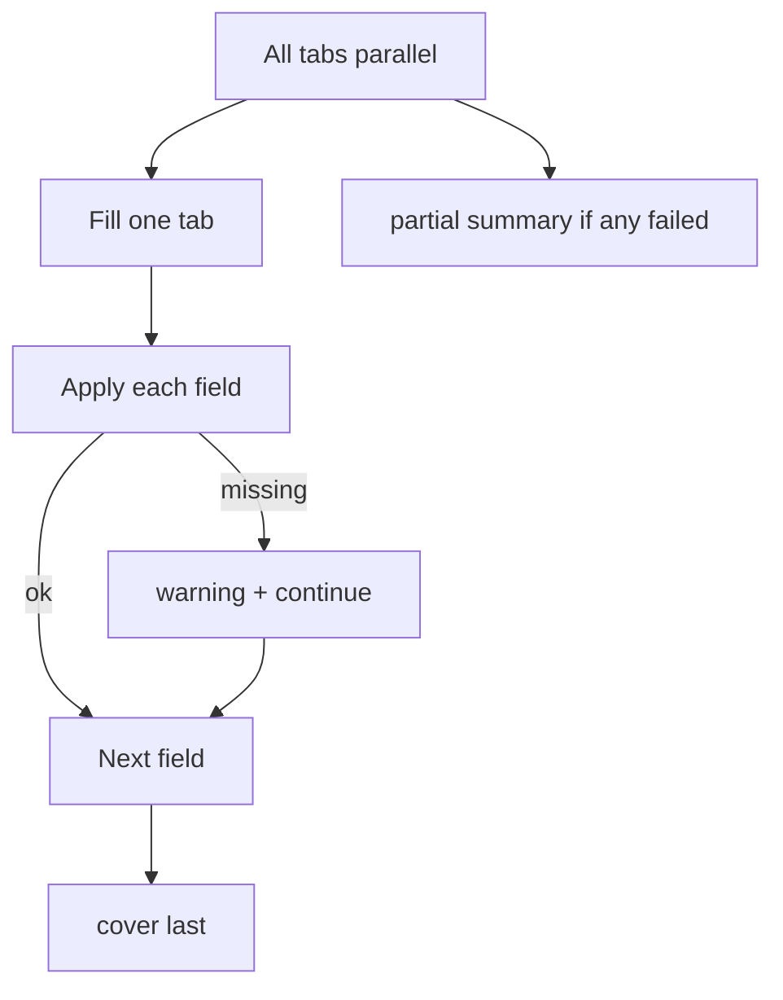

# Resilient field fill + continue batch on tab errors

## Problem

- `page_fields_not_found:分区 → 科技数码` stopped the whole tab (and often the batch).
- Partition label `科技数码` did not match UI variants like `科技 · 数码`.

## Fix

**Per tab (content script)**

- Missing fields are logged as progress warnings (`skipped field: …`) and fill continues (title, tags, cover, etc.).
- Form-ready wait only requires a visible title; partition has its own dropdown waits.
- Partition labels match with compact comparison (ignore spaces/`·`).

**Batch (service worker)**

- All slots on a platform run even when another tab fails.
- End state: `batch_partial_failed` with a summary if some tabs failed; all-failed still returns the first tab error.

## Workflow

