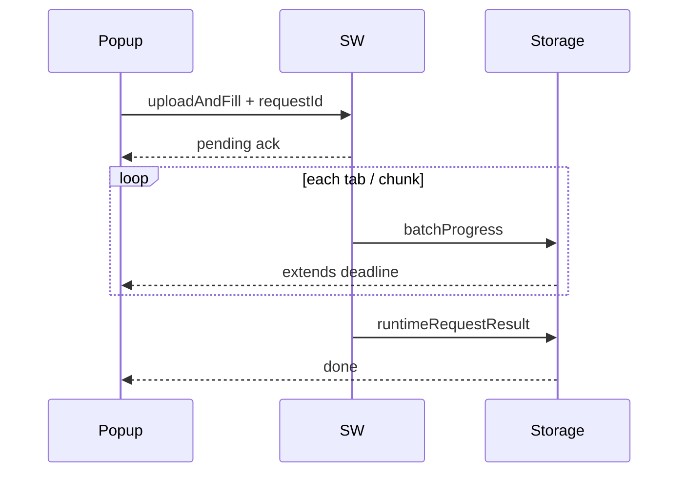

# Fix: service_worker_no_response on long batch upload

## Problem

Popup showed `service_worker_no_response` during **Upload and fill (all tabs)** even after reloading the extension.

## Causes

1. Popup waited only **130s** while chunked video transfer across many tabs can take longer.
2. Keep-alive was released after the **upload** phase, so the MV3 service worker could sleep before **fill** started.
3. Chunked `tabs.sendMessage` per video frame increases total runtime.

## Fix

- Keep service worker alive for the **entire** background runtime job (`runWithServiceWorkerKeepAlive` in `sw.ts` and upload+fill path).
- Batch actions timeout: **15 minutes**; open-tabs: **60 seconds**.
- Extend the popup wait by **3 minutes** whenever batch progress storage updates for the same `requestId`.

## Workflow

