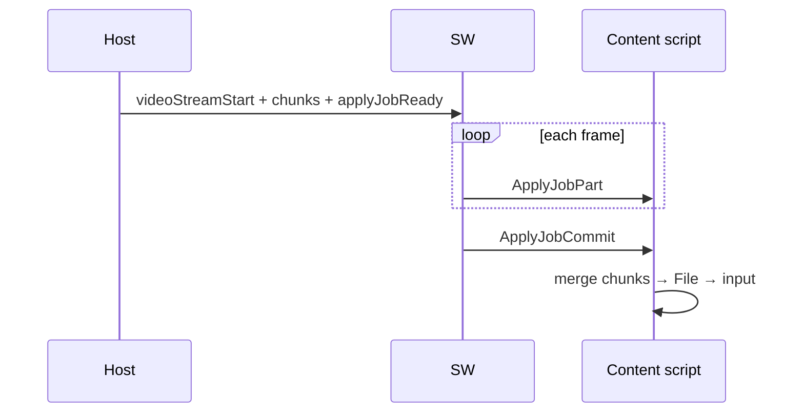

# Fix: tab_apply_failed — Chrome 64 MiB sendMessage limit

## Problem

Upload failed with `tab_apply_failed` and `Message exceeded maximum allowed size of 64MiB` even when each `.mp4` was under 64 MB on disk.

## Cause

Native host already streams video in ~256 KiB frames, but the service worker **merged** all chunks into one `inlineBase64Chunks` payload and sent it in a **single** `tabs.sendMessage`. Base64 expands size (~4/3), so a ~50 MB file can exceed Chrome’s 64 MiB message cap.

## Fix

- Forward the native host batch to the content script **part by part** (`ApplyJobStreamBegin` → `ApplyJobPart` × N → `ApplyJobCommit`).
- Merge streams in the **content script** (same helpers as before, moved to `extension/src/shared/`).
- Keep a single `ApplyJob` message only for small payloads that fit under `TAB_MESSAGE_SAFE_BYTES` (90% of 64 MiB).

## Workflow

