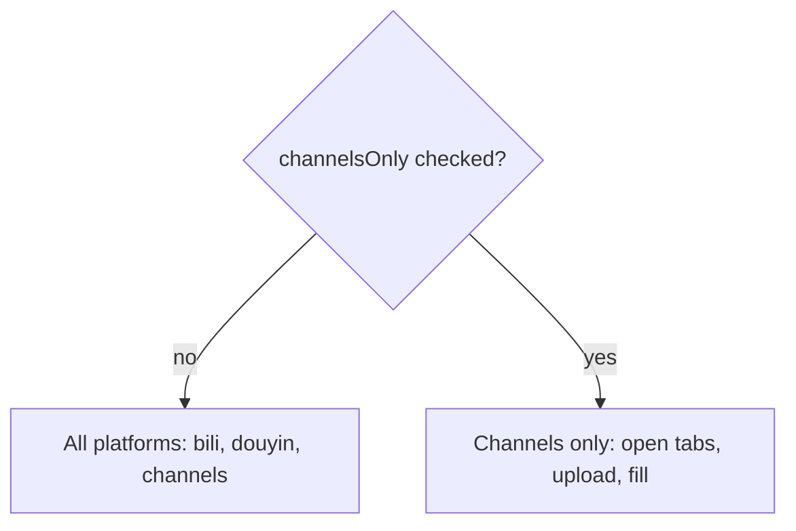

# 视频号-only batch option

## Problem

WeChat (视频号) may block multiple uploads in a short window. User needs to re-upload and fill fields later for a subset of job items without touching bilibili/douyin tabs.

## Fix

- Popup checkbox **视频号 only (re-upload)** — persisted as `semiAutoChannelsOnly`
- When checked, **Open tabs** and **Upload and fill** scope to `channels` only
- Tab validation and slot building use `resolveBatchPlatformIds(channelsOnly)`

## Workflow

