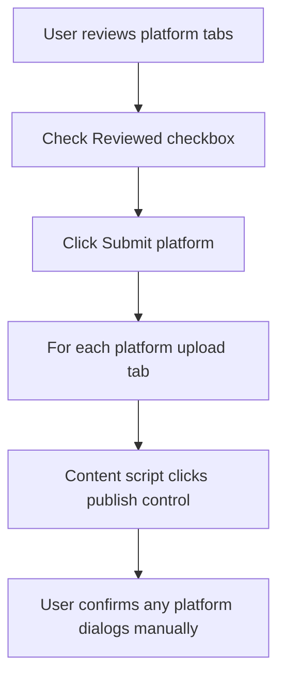

# Platform auto-submit after review

## Problem

After upload and fill, user reviews each platform manually but clicking publish on every tab is tedious.

## Fix

- Popup section **Publish (after review)** with per-platform:
  - **Reviewed** checkbox (must be checked before submit)
  - **Submit** button (clicks publish on all tabs for that platform)
- Content script finds and clicks platform submit controls:
  - **bilibili:** `.submit-add` / 立即投稿
  - **douyin:** button 发布
  - **视频号:** `button.weui-desktop-btn_primary` 发表
- Service worker `runtime.submitPlatformTabs` runs tabs sequentially with stagger; 视频号 tabs are activated first.

## Workflow

