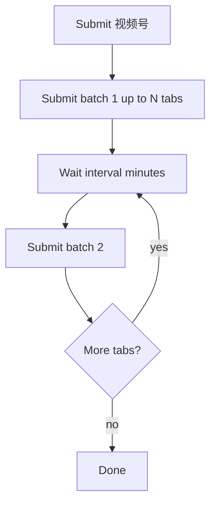

# 视频号 batched submit

## Problem

视频号 rate-limits rapid consecutive publishes. Submitting many tabs at once can fail.

## Fix

- Popup **视频号 batch size** (default 5) and **Batch interval (min)** (default 5)
- `submitPlatformTabs` for 视频号 submits tabs in batches, waits between batches
- Bilibili and douyin still submit all tabs sequentially with short stagger
- Runtime timeout scales with batch interval for long 视频号 submit runs

## Workflow

