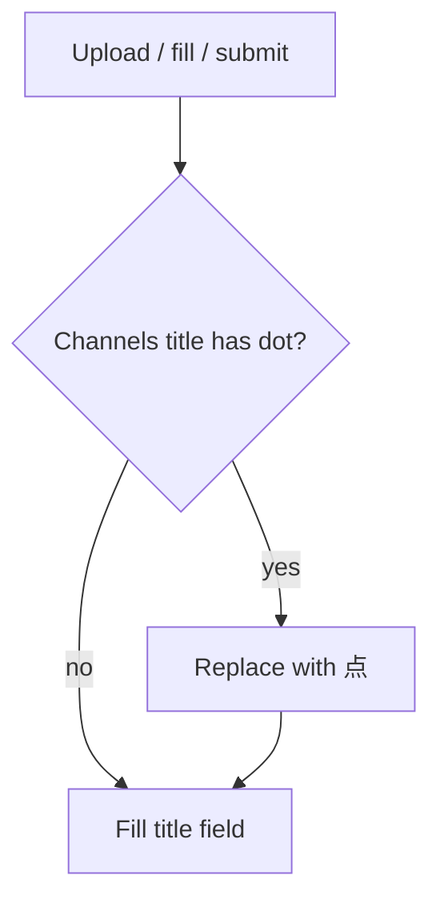

# Remove batch item name length checks

## Problem

Name length validation blocked upload/fill/submit when any item exceeded 17 chars. No longer needed.

## Fix

- Removed `MAX_BATCH_ITEM_NAME_LENGTH`, overlong listing, block messages, and assert helpers
- Upload/fill/submit no longer inspect job names for length
- Kept `normalizeChannelsTitle` (`.` → `点`) for 视频号 title fill

## Workflow

