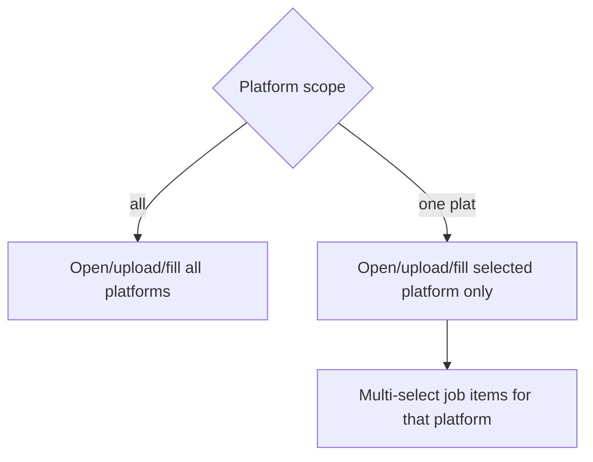

# Single-platform batch scope (bilibili / douyin / 视频号)

## Problem

视频号-only re-upload existed, but bilibili and douyin needed the same workflow: open tabs, upload, and fill for one platform only.

## Fix

- Popup **Platform scope** select: all / bilibili / douyin / 视频号
- Single-platform scope opens tabs for that platform only
- Upload and fill runs on that platform only, with per-item multi-select (same as former 视频号 flow)
- Persisted as `semiAutoBatchPlatformScope`

## Workflow

