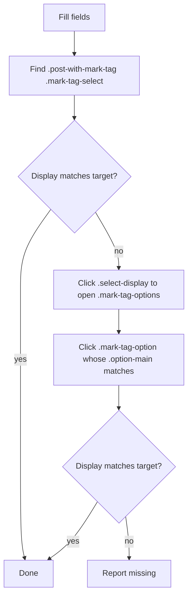

# 视频号 内容标注 (视频标注) mark-tag

## Scope

- New 视频号 element `.post-with-mark-tag` dropdown (`.mark-tag-select`).
- Placeholder `选择视频标注`; options inside `.mark-tag-options > .mark-tag-option` (`.option-main`).
- Options: 无需标注 / 含AI生成内容 / 内容为虚构剧情，仅供娱乐 / 个人观点，仅供参考 / 内容包含营销广告 / 内容为自行拍摄 / 内容为转载.
- Default selection: `个人观点，仅供参考` (configurable via `channels.markTag`).

## Workflow



## Job

```json
"channels": { "title": "…", "markTag": "个人观点，仅供参考" }
```

`channels.markTag` optional; defaults to `CHANNELS_DEFAULT_MARK_TAG_OPTION`. Batch item `markTag` projects to channels.
