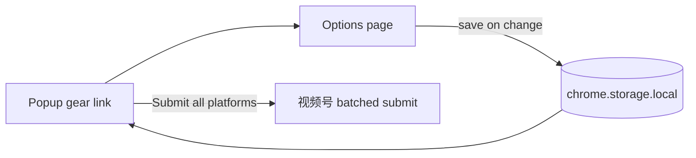

# 视频号 batch settings moved to an options page

## Problem

The popup showed 视频号 **batch size** and **Batch interval (min)** inline, cluttering the
publish controls with settings that rarely change.

## Change

- New extension options page (`extension/options.html`, `extension/src/options/*`),
  registered via `options_ui` (`open_in_tab: true`) in `extension/manifest.json`.
- Popup keeps only the **Submit all platforms** button. The options page is
  reached from the browser's extension settings (the popup gear link was later
  removed — see `2026-10-02-popup-layout-cleanup-chinese-ui.md`).
- Popup reads the stored batch config from `chrome.storage.local`
  (`channelsSubmitBatchSize`, `channelsSubmitBatchIntervalMin`) at submit time.
- Settings save on `change`, clamp to the existing ranges, and show a brief "Saved" status.
- esbuild builds the new `options` entry point (`extension/dist/options.js`).

## Workflow

