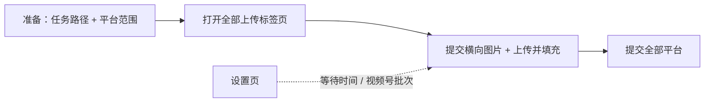

# Popup layout cleanup and Chinese UI

## Problem

The popup mixed preparation inputs with actions, showed internal implementation
copy ("Batch job (v3)…"), kept the rarely-used "Wait after upload before fill (ms)"
next to upload controls, and displayed long help paragraphs under each button.
All UI text was also English while the product itself targets Chinese creators.

## Change

- Removed the "Batch job (v3) — …" tagline; the popup header is just the product name.
- Grouped **批量任务文件路径** and **平台范围** into one preparation section.
- Moved the open-tabs action into its own section, away from preparation.
- Moved **上传后、填充前的等待时间（毫秒）** to the options page
  (`extension/src/options/fields-settle-settings.ts`, stored in `semiAutoFieldsSettleMs`).
- Placed **提交横向图片** directly above **上传并填充（全部标签页）**.
- Replaced the long button explanations with `title` tooltips; the dynamic help
  paragraph is now localized and still updated per platform scope.
- Hid the 视频号 batch settings entry from the popup UI; the options page is still
  registered in the manifest and reachable from the browser's extension settings.
- Translated all popup and options user-facing text to Chinese and switched
  `lang="zh-CN"`.

## Workflow

